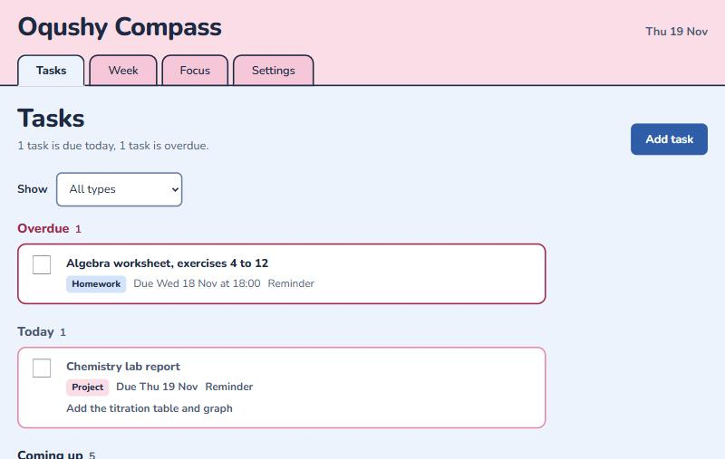
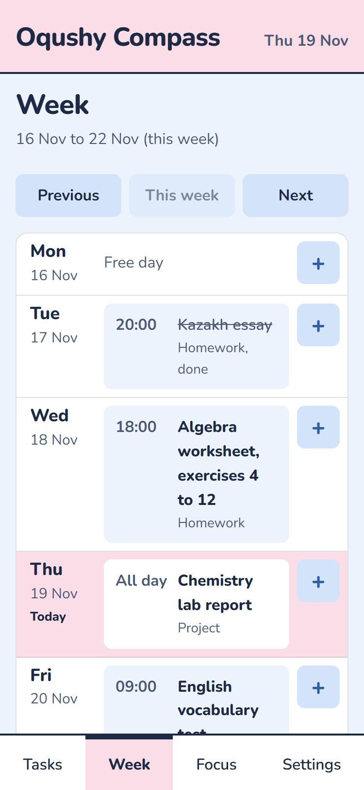
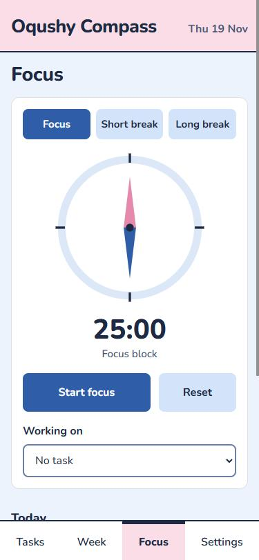
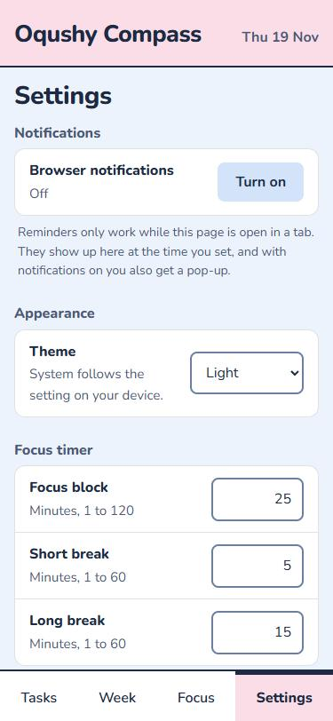

<h1 align="center">Oqushy Compass</h1>

<p align="center">
  A planner for school students, with deadlines, a week view and a focus timer.<br>
  It runs in the browser and keeps everything on your device.
</p>

<p align="center">
  
</p>

<table align="center">
  <tr>
    <td align="center"></td>
    <td align="center"></td>
    <td align="center"></td>
  </tr>
  <tr>
    <td align="center">Week</td>
    <td align="center">Focus</td>
    <td align="center">Settings</td>
  </tr>
</table>

## What it does

### Tasks

Every task has a type (homework, project, research or activity), an optional due date
and time, and room for notes. The list sorts itself into **Overdue**, **Today**,
**Coming up** and **No date**, and finished tasks fold away at the bottom.

Tap a task to edit it. If you delete one by mistake, Undo brings it back for about
ten seconds.

### Week

One row per day, Monday to Sunday, with today in pink. The **+** on a day adds a task
that is already dated for it. Previous and Next switch weeks.

### Reminders

Pick when to be reminded: at the due time, or 10 minutes, 1 hour or 1 day before.
If a task has no time, the reminder counts from 09:00 on the due date.

The reminder shows up on the page. If you allow browser notifications in Settings,
you also get a pop-up.

### Focus

A Pomodoro timer with three modes: focus block, short break and long break
(25, 5 and 15 minutes unless you change them). The compass needle turns once over
each block. After every fourth focus block the timer suggests the long break.

You can pick which task you're working on, and the blocks you finish are listed under
**Today**.

### Settings

Browser notifications, the theme (system, light or dark) and the timer lengths.

## Run it on your computer

There is nothing to install and no build step. Either open `index.html` in a browser,
or serve the folder:

```
python -m http.server 8000
```

and go to `http://localhost:8000`.

## Put it online

The repo can be served with GitHub Pages:

1. Open the repo on GitHub and go to **Settings > Pages**.
2. Under **Source**, choose **Deploy from a branch**.
3. Pick `main` and `/ (root)`, then **Save**.

After a minute or two the site is at `https://kormaixh-ui.github.io/OqushyCompass/`.

## Where your data goes

Tasks, focus sessions and settings are saved in your browser's `localStorage`, under
the key `oqushy.v1`. There is no account and no server, and nothing is sent anywhere.

That also means:

- Clearing this site's data in your browser deletes your tasks.
- A private window doesn't keep anything after you close it.
- Tasks don't sync between your phone and your laptop.

## Limits

- Reminders only fire while the page is open in a tab. Without a server there is no
  way to wake the page up.
- It has been tested in a Chromium-based browser at laptop and phone sizes. Firefox
  and Safari should work, but they haven't been checked yet.

## Files

| File | What's in it |
| --- | --- |
| `index.html` | The page and all four screens |
| `styles.css` | Colours, layout, light and dark theme |
| `app.js` | Tasks, saving, reminders, week view and the timer |
| `screenshots/` | The pictures in this README |
